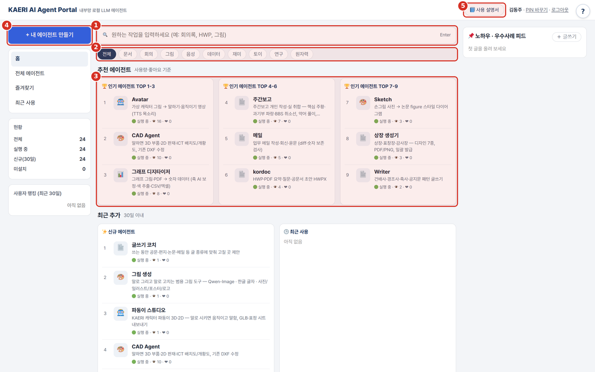
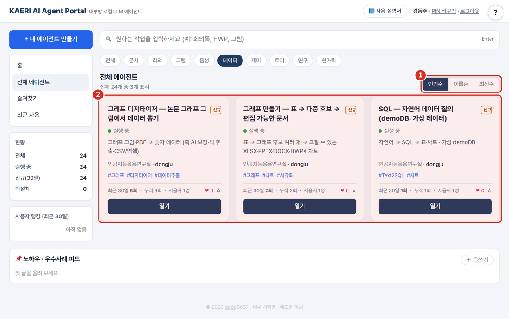
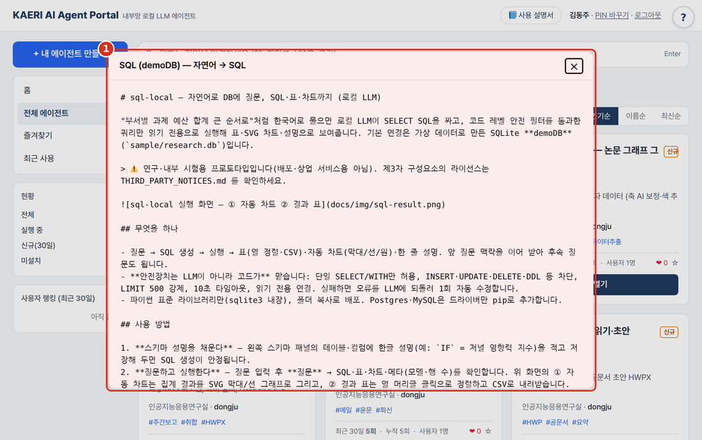
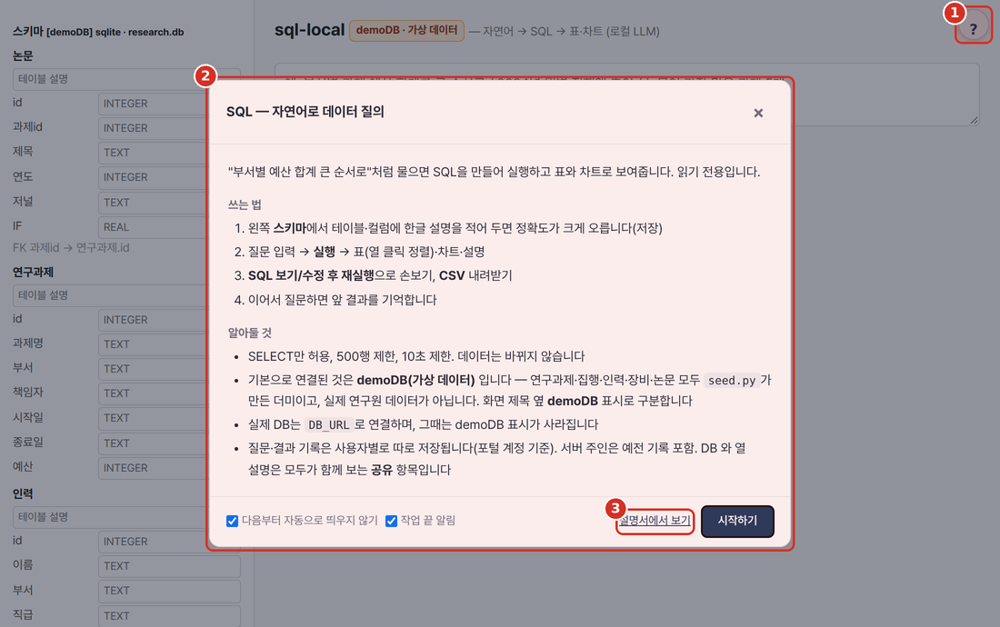

# agent-page-portal — 에이전트 페이지 포털

> **한 줄 요약** — 같은 상위 폴더에 나란히 둔 로컬 LLM 도구 25개(목록 노출 24개)를 한 화면에 모은 포털. 검색·카테고리로 도구를 찾고, `/t/<도구>/` 프록시로 UI를 열고, README·사용법 팝업·시작/중지·사용 통계를 한곳에서 다룹니다. 파이썬 표준 라이브러리만.
> 각 도구는 **따로따로 별도 저장소**로 공개되어 있고, 이 저장소는 그 도구들을 묶어 띄우는 포털입니다.

> ⚠️ 연구·내부 시험용 프로토타입입니다(배포·상업 서비스용 아님). 제3자 구성요소의 라이선스는 THIRD_PARTY_NOTICES.md 를 확인하세요.



## 사용 방법
번호는 화면의 번호 상자와 같습니다. 처음 들어오면 **로그인 겸 소개 화면**(`/login` — 한 줄 소개·홈 캡처·장점·분류별 도구 수·"처음이라면" 3단계)이 뜹니다 — 오른쪽 카드의 '처음이에요'에서 아이디(영문 소문자·숫자)·이름·부서·PIN(숫자 4~8자리)으로 가입하면 바로 들어가고, 첫 로그인 때 **1분 둘러보기**(환영 창에서 부서·테마 고르기 → 검색·분류·? 사용법·계정 설정을 차례로 비춤)가 뜹니다. 건너뛰어도 **?** 창의 '둘러보기 다시 보기'로 다시 볼 수 있습니다. PIN 은 서버에 해시로만 저장되고, 잊으면 관리자가 초기화합니다.

1. **검색**(홈 ①) — 도구 이름·설명·태그를 한 번에 찾습니다(예: 회의록, HWP, 그림).
2. **카테고리 칩**(홈 ②) — 문서·회의·그림·음성·데이터·재미·토이·연구·원자력으로 목록을 좁힙니다.
3. **홈 요약**(홈 ③) — 인기 TOP·신규·최근 사용 카드에서 바로 고릅니다. 사용자 랭킹은 계정 이름으로 표시됩니다(IP 는 보이지 않음).
4. **내 에이전트 만들기**(홈 ④) — 새 도구 등록 안내로 연결됩니다. 오른쪽 위 **📘 사용 설명서**(홈 ⑤)는 도구마다 쓰는 순서를 화면으로 정리한 설명서(`/guide/`, PDF 내려받기)를 엽니다.
5. **전체 에이전트** 목록에서 정렬(이름순·최신순, 아래 ①)과 카테고리 필터로 카드를 고르고 **열기**(아래 ②) — 또는 `http://<포털>:8700/t/<도구폴더>/` 로 바로 갑니다.
6. 카드의 **README**는 저장소 설명을, 도구 화면 오른쪽 위 **?**(아래 ①)는 `guides/<도구폴더>.md` 짧은 사용법(②)을 열고, **설명서에서 보기**(③)는 설명서의 그 도구 부분으로 갑니다.

<p>


</p>



## 예시
SQL 도구로 프록시 진입(같은 세션 캡처): `http://localhost:8700/t/sql-local/` → demoDB(가상 데이터)에 질문 "부서별 과제 예산 합계를 큰 순서로" →

```sql
SELECT "부서", SUM("예산") AS "예산합계"
FROM "연구과제" GROUP BY "부서"
ORDER BY "예산합계" DESC LIMIT 500
```

5행 · gemma4:31b · 표·SVG 차트 생성. 각 도구는 자체 `app.py`·`ui.html` 로 동작하고, SSE·파일 다운로드도 포털이 그대로 전달합니다.

## 포털이 하는 일
- **목록·검색** — `tools.json`(요청마다 다시 읽음)에 적힌 도구를 카드로 보여 줌. "+ 내 에이전트 만들기"로도 추가. `"hidden": true` 면 목록에서 숨김(프록시는 됨).
- **시작/중지** — 각 도구 폴더의 `setup.sh` 를 `PORT`·`WORKSPACE` 를 넘겨 실행. `python3 portal.py start-all` / `stop-all`.
- **단일 진입점(프록시)** — 모든 도구를 `http://<포털>:8700/t/<도구폴더>/` 로 리버스 프록시(SSE·파일 다운로드 포함). 포트 하나만 열면 되고, 도구 UI 는 상대경로만 씀. 도구는 `127.0.0.1` 에만 열려 있어 직접 포트로는 접속할 수 없음.
- **사용법 팝업** — 프록시하는 도구 첫 화면에 `guides/<도구폴더>.md` 를 오른쪽 위 **?** 팝업으로 붙임(포털 자체는 `guides/portal.md`).
- **로그인** — 계정은 `portal.db` 의 `users`(아이디·이름·부서·PIN 의 pbkdf2-sha256 해시 + 사용자별 salt, 60만 회 — 예전 20만 회 계정은 다음 로그인 때 자동으로 다시 해시). 세션은 무작위 32바이트 토큰(DB 에는 sha256 만), 쿠키 `agsid`(HttpOnly·SameSite=Lax, 30일, 쓰면 연장 — 로그인 화면의 '이 PC에서 로그인 유지'를 끄면 Max-Age 없는 쿠키 + 서버 만료 12시간·연장 없음, `sess_short` 표). 로그인 실패는 아이디당 10분에 5번까지. 로그인 안 한 화면 요청은 `/login?next=…` 로, API 는 401. 접속 IP 는 NAT 뒤라 모두 서버 주소로 보이므로 사람 구분에 쓰지 않습니다 — 단, 이 서버 안(127.0.0.1)에서 쿠키 없이 + 비밀 헤더 `X-Local-Owner`(값 = `_data/.local_owner_token`)를 붙인 요청(스크립트·내부 호출)만 서버 주인으로 봅니다 — 헤더 없는 브라우저(SSH 포트포워딩 포함)는 늘 로그인 필요(무효 쿠키가 있으면 다시 로그인). 아래 'FastAPI 포털' 의 `PORTAL_LOCAL_OWNER`. 계정 만들기·PIN 초기화: `python3 portal.py --add-user <id> --name <이름> [--dept 부서] [--pin 숫자]`(PIN 을 안 주면 무작위 6자리를 화면에만 출력).
- **통계·피드** — `AGENT_DATA/portal.db` sqlite 하나(WAL)에 열기·좋아요·피드 글·사용자 랭킹(계정 id 기준, 랭킹은 이름으로 표시). 즐겨찾기·최근 사용·펫 상태는 브라우저 localStorage(펫·사용법 팝업은 계정별 키).
- **계정·부서·권한** — 역할은 관리자(`AGENT_OWNERS` 계정) · 부서장(부서마다, 여럿 가능) · 일반. 오른쪽 위 **계정 설정**(`/account`)에서 이름 바꾸기, 부서 소속 요청, 부서장 권한 요청, PIN 바꾸기, 내 요청 보기·취소.
  - 부서는 관리자가 만든 목록에서만 고름(`depts` — 처음엔 기존 계정·`tools.json` 의 부서로 채움). 목록에 없으면 관리자에게 요청.
  - 부서 소속(가입 때 고른 부서 포함)은 **요청 → 그 부서 부서장 승인**(부서장이 없으면 관리자) 뒤에 반영, 그 전엔 '승인 대기'. 대기 요청은 종류마다 하나. 다른 부서로 옮기면 예전 부서의 부서장 권한은 내려놓음.
  - 부서장 권한은 **관리자에게** 요청 → 승인. 관리자는 직접 지정·회수도 함.
  - 승인할 사람은 위쪽 막대의 **요청 N** 배지와 화면 알림으로 알고 **승인**(`/approvals`)에서 승인·거절(메모 선택). 요청한 사람은 다음 화면을 열 때 결과 알림을 받음.
  - **부서장이 할 수 있는 것**: 자기 부서 소속 요청 승인·거절, 자기 부서 구성원 목록과 각자 포털에서 도구를 연 횟수(최근 30일·누적)·마지막 접속 보기. 그 밖에는 일반 사용자와 같고, 도구 쪽 권한·기록 공유는 바뀌지 않음.
  - **관리**(`/admin`, 관리자만): 계정 목록(부서·역할·가입·마지막 접속), 부서 추가·이름 바꾸기·숨기기, 부서장 지정·회수, 모든 대기 요청, PIN 초기화(무작위 6자리를 한 번만 보여 줌), 계정 정지·해제, 감사 기록.
  - API 는 `/api/account/*` · `/api/approvals/*` · `/api/admin/*` — 모든 호출에서 서버가 역할을 확인(아니면 403). 승인·거절·부서장 지정/회수·PIN 초기화·정지·부서 변경은 `audit` 표에 남김.
- **사용자 구분** — 도구로 넘길 때 `X-Agent-User` 헤더를 포털이 붙임(클라이언트가 보낸 `X-Agent-User`·`X-Forwarded-User`·`X-User` 와 포털 세션 쿠키는 버림): 주인 계정(`AGENT_OWNERS`)은 `owner`, 나머지는 계정 id. 도구는 이 값으로 기록을 사용자별 폴더에 나눠 저장하고, 포털은 도구를 `BIND=127.0.0.1` 로 띄워 포털을 거쳐서만 열리게 함. `/api/me` → `{id, name, owner, role, dept, dept_pending, heads, approvals}`.
- **화면 테마** — 위쪽 막대 **🎨 테마** 또는 계정 설정에서 클래식·트렌디·v2 × 밝게·어둡게(+ 컴퓨터 설정 따라 자동). v2 는 포털 화면 배치도 다름(왼쪽 메뉴·현황 타일·Ctrl+K 명령 팔레트 — `v2/home.html`·`v2/account.html` 마크업(로그인 화면 `login.html` 은 모든 테마가 한 배치, 색·모양만 토큰) + `theme/portal-v2.css`, 스크립트는 원래 화면 것 그대로), v2 ↔ 다른 계열로 바꾸면 포털 화면은 자동 새로고침. 계정에 저장(`users.theme`, 로그인 전·로컬 접속은 쿠키 `agtheme`), `GET/POST /api/account/theme`. 포털이 모든 화면(포털·설명서·도구 첫 화면) `<head>` 앞에 `theme/boot.js` 와 `/theme/*.css` 를 붙임 — 클래식 밝게는 CSS 를 안 붙여 예전 화면 그대로. 어둡게는 `theme/dark.js` 가 도구 CSS 의 고정 색을 명도만 바꿔 맞춤(그림·캔버스는 그대로). 도구별 손질은 `theme/tools/<도구>.css` — 방법은 `theme/THEME_GUIDE.md`.
- **작업 알림 센터** — 도구가 알린 작업(protein·battery·avatar·image·meeting·review·agent-cad — `sdk/portal_jobs.py`)과 1분 넘게 걸린 도구 요청(자동 기록)을 `portal.db` 작업 표에 남기고(재시작해도 남음) `/api/jobs/stream`(SSE)으로 바로 전달 — React 화면은 오른쪽 위 🔔(안 읽은 개수·진행·결과 보기·모두 읽음)·토스트, 예전 화면은 왼쪽 아래 알림 + 탭 제목 깜빡임. 브라우저 알림은 계정 설정에서 켠 경우만(탭이 가려져 있을 때). 자기 작업만(주인은 전부). 끄기: **?** 사용법 창 아래 '작업 끝 알림'. 도구 쪽 방법: `docs/api/README.md` '도구가 작업 상태를 알리는 법'.
- **GPU 현황** — 홈 아래에 GPU별 메모리·사용률과 어느 도구가 쓰는지(`/api/gpu`, 5초 캐시, 10초마다 새로고침). 컨테이너 안에서는 `nvidia-smi` 의 pid 가 호스트 pid 라 생성 순서·GPU 집합으로 짝지은 **추정**입니다.
- **백업** — `backup.sh`: `_data` 전체(캐시·모델·가상환경 제외, sqlite 는 backup API 로 일관된 사본)를 `~/agent-page-backup/agent-data-<날짜>.tar.gz` 로, 최근 7일치만 남김(로그 `backup.log`). 운영 포털(:8700)이 매일 03시(KST)쯤 부르고, `autostart.sh` 가 재시작 직후 한 번 부름. 되살리기: `tar xzf <파일> -C <상위폴더>`. 위치 `AGENT_BACKUP_DIR`, 개수 `BACKUP_KEEP`.
- **점검** — `bash audit.sh`: 도구별 CDN 유출·포트 중복·LICENSE/NOTICE·selftest.

## 연결된 도구 (24개, `tools.json` 기준 · 숨긴 도구 제외)

| 이름 | 폴더 | 포트 | 분류 | 하는 일 | 저장소 | 목록 |
|---|---|---|---|---|---|---|
| Humanize KR | `humanize-kr-local` | 8765 | 문서 | AI가 쓴 한글의 번역투·상투구 제거 | [gggg8657/humanize-kr-local](https://github.com/gggg8657/humanize-kr-local) | 보임 |
| kordoc | `kordoc-local` | 8766 | 문서 | HWP·PDF 요약·질문·공문서 초안 HWPX | [gggg8657/kordoc-local](https://github.com/gggg8657/kordoc-local) | 보임 |
| Notebook | `notebook-local` | 8769 | 문서 | 출처 올리고 인용 채팅·노트·팟캐스트 대본 | [gggg8657/notebook-local](https://github.com/gggg8657/notebook-local) | 보임 |
| Writer | `writer-local` | 8773 | 문서 | 건배사·경조사·축사·공지문 패턴 글쓰기 | [gggg8657/writer-local](https://github.com/gggg8657/writer-local) | 보임 |
| Meeting | `meeting-local` | 8767 | 회의 | 녹음 → 화자 분리 → 회의록·인사이트 | [gggg8657/meeting-local](https://github.com/gggg8657/meeting-local) | 보임 |
| Diagram | `diagram-local` | 8768 | 그림 | 말로 설명하면 다이어그램 | [gggg8657/diagram-local](https://github.com/gggg8657/diagram-local) | 보임 |
| Sketch | `sketch-local` | 8774 | 그림 | 손그림 사진 → 논문 figure 스타일 다이어그램 | [gggg8657/sketch-local](https://github.com/gggg8657/sketch-local) | 보임 |
| TTS | `tts-local` | 8771 | 음성 | 한국어 음성 합성 (OpenAI 음성 API 호환) | [gggg8657/tts-local](https://github.com/gggg8657/tts-local) | 보임 |
| SQL (demoDB) | `sql-local` | 8772 | 데이터 | 자연어 → SQL → 표·차트 · **기본 DB 는 가상(합성) demoDB** — 실제 DB 는 운영자가 연결 | [gggg8657/sql-local](https://github.com/gggg8657/sql-local) | 보임 |
| 팀 밸런스 맵 | `saju-local` | 8775 | 재미 | 사주·MBTI 협업 궁합 (워크숍용) | [gggg8657/saju-local](https://github.com/gggg8657/saju-local) | 보임 |
| Avatar | `avatar-local` | 8777 | 그림 | 가상 캐릭터 그림 → 말하기(Wan2.2-S2V)·움직이기(Wan2.2-I2V) 영상, 목소리는 tts-local | [gggg8657/avatar-local](https://github.com/gggg8657/avatar-local) | 보임 |
| CAD Agent | `agent-cad-local` | 8778 | 그림 | 말하면 3D 부품·2D 판재·ICT 배치도/개황도, 기존 DXF 수정 | [gggg8657/agent-cad-local](https://github.com/gggg8657/agent-cad-local) | 보임 |
| 상장 생성기 | `award-local` | 8779 | 문서 | 상장·표창장·감사장 — 디자인 7종, PDF/PNG, 일괄 발급 | [gggg8657/award-local](https://github.com/gggg8657/award-local) | 보임 |
| 메일 | `mail-local` | 8780 | 문서 | 업무 메일 작성·회신·윤문 (diff·숫자 보존 검사) | [gggg8657/mail-local](https://github.com/gggg8657/mail-local) | 보임 |
| 단백질 구조 예측 | `protein-local` | 8781 | 연구 | 서열 → 3D 구조·pLDDT·PAE, 결합 친화도 순위, 서열 설계 (Boltz-2 + ProteinMPNN, 폐쇄망) | [gggg8657/protein-local](https://github.com/gggg8657/protein-local) | 보임 |
| 그래프 디지타이저 | `digitizer-local` | 8783 | 데이터 | 그래프 그림·PDF → 숫자 데이터 (축 AI 보정·색 추출·CSV/엑셀) | [gggg8657/digitizer-local](https://github.com/gggg8657/digitizer-local) | 보임 |
| 논문 리뷰 | `review-local` | 8782 | 문서 | 투고 전 원고 사전 심사 — 인용 확인된 심사 지적·예상 판정·예상 질문 + 그림·인용·약어·수치 기계 점검 | [gggg8657/review-local](https://github.com/gggg8657/review-local) | 보임 |
| 그래프 | `chart-local` | 8786 | 데이터 | 표 → 그래프 후보 여러 개 → 고칠 수 있는 XLSX·PPTX·DOCX·HWPX 차트 | [gggg8657/chart-local](https://github.com/gggg8657/chart-local) | 보임 |
| 차폐 계산기 | `shield-local` | 8784 | 원자력 | 방사선 차폐·선량 간이 계산 — 점선원 감마, 축적인자, 필요 두께 역산, 누적선량 | [gggg8657/shield-local](https://github.com/gggg8657/shield-local) | 보임 |
| 배터리 | `battery-local` | 8785 | 연구 | PyBaMM 배터리 성능·수명(열화) 예측 — C-rate·충전·SOH·EOL·LLI/LAM | [gggg8657/battery-local](https://github.com/gggg8657/battery-local) | 보임 |
| 주간보고 | `weekly-local` | 8788 | 문서 | 주간보고 개인 작성·실 취합 — 핵심 주황·과기부 파랑·BBS 취소선, 약어 풀이, HWPX·DOCX | [gggg8657/weekly-local](https://github.com/gggg8657/weekly-local) | 보임 |
| 파동이 | `padong-local` | 8789 | 토이 | KAERI 캐릭터 파동이 3D·2D — 말로 시키면 움직이고 말함, 날짜별 옷, 포털 모든 화면을 돌아다니는 펫 | [gggg8657/padong-local](https://github.com/gggg8657/padong-local) (비공개 — 캐릭터 권리는 KAERI·허쉬위쉬) | 보임 |
| 그림 생성 | `image-local` | 8792 | 그림 | 말로 그리고 말로 고치는 범용 그림 도구 — Qwen-Image-2512 · Qwen-Image-Edit-2509 | [gggg8657/image-local](https://github.com/gggg8657/image-local) | 보임 |
| 글쓰기 코치 | `coach-local` | 8798 | 문서 | 쓰는 동안 공문·편지·논문·메일 등 글 종류(페르소나)·목적에 맞춰 고칠 곳을 준실시간으로 제안 | [gggg8657/coach-local](https://github.com/gggg8657/coach-local) | 보임 |

'목록'은 `tools.json` 의 `hidden` 값입니다(현재 값 그대로). 숨긴 도구는 일반 포털 목록에서만 빠지고, 테스트 포털(`SHOW_HIDDEN=1`)에서는 보입니다.

## 도구가 연결되는 방식

```
브라우저 ──▶ portal.py :8700 ──/t/<dir>/──▶ 127.0.0.1:<port> (각 도구 app.py)
                │  시작할 때 넘기는 환경변수: PORT, WORKSPACE=$AGENT_DATA/<dir>, 그리고 포털이 받은 환경 전부
                └─ 첫 화면 HTML 에 guides/<dir>.md 사용법 팝업(?) 삽입
도구들 ──▶ LLM_BASE_URL (로컬 vLLM, OpenAI 호환, 기본 gemma4:31b)   notebook 임베딩 ──▶ EMBED_BASE_URL (로컬 Ollama, bge-m3)
notebook / avatar ──▶ TTS_BASE_URL(tts-local) · STT_BASE_URL(meeting-local) · AVATAR_URL(avatar-local)
```

- **API** — 화면과 처리는 JSON HTTP API 로만 주고받습니다. 새 화면을 붙이거나 다른 프로그램에서 부르려면 [docs/api/README.md](docs/api/README.md)(로그인·연결 방법·포털 API)와 도구별 `docs/api/<dir>.md` 를 보세요.
- **데이터 한곳에** — `AGENT_DATA`(기본 `../_data`) 아래에 `portal.db` 와 각 도구의 작업 폴더(`_data/<도구>/…`)가 모입니다. 포털이 도구를 띄울 때 `WORKSPACE=$AGENT_DATA/<도구>` 를 넘기고, 모든 도구가 그 변수를 읽습니다. 백업은 이 폴더 하나. (이 폴더는 어느 저장소에도 올리지 않습니다.)
- **LLM** — `start-portal.sh` 가 `LLM_API=openai LLM_BASE_URL=http://127.0.0.1:11440/v1 LLM_MODEL=gemma4:31b MODEL=… VISION_MODEL=…` 를 export 하고 포털이 그대로 도구에 물려 줍니다. 모든 도구는 OpenAI 호환(`/v1/chat/completions`) 또는 Ollama API 로 이 주소를 부릅니다(외부 인터넷 불필요).
  - 서버: [vLLM](https://github.com/vllm-project/vllm)(OpenAI 호환, `--served-model-name gemma4:31b`, `--max-model-len 32768`, 전용 GPU 1장). `start-portal.sh` 는 vLLM 을 띄우지 않고 응답이 없으면 경고만 냅니다.
  - **모델 바꾸기 — `scripts/vllm-switch`**: 설정 파일(`$VLLM_DIR/models.json`, 예시 `scripts/vllm-models.example.json`)에 이름표별 가중치 경로·형식·`vllm serve` 옵션을 적고 `vllm-switch --list` · `--current` · `<이름표> --dry-run`(가중치·디스크·GPU 메모리 사전 확인만) · `<이름표>`(지금 vLLM 을 정확한 PID 로 끄고 새 설정으로 기동 → `/v1/models`·짧은 대화·`json_object`·이미지 입력 확인 → 실패하면 이전 설정으로 자동 롤백). 도구에 보이는 이름은 `served_name`(gemma4:31b)으로 고정이라 도구 재시작이 필요 없습니다(`--served-name` 으로 바꿀 수 있음). 가중치는 자동으로 받지 않습니다. 경로·포트·GPU 는 환경변수(`VLLM_DIR`·`VLLM_BIN`·`VLLM_PORT`·`VLLM_GPUS` 등)라 다른 서버에도 그대로 씁니다.
  - **자동 기동·감시 — `scripts/llm-watchdog.sh`**: `autostart.sh` 가 로그인 때마다 부르고(flock 으로 하나만) 1분마다 vLLM `/health`·Ollama `/api/version` 을 봅니다. 꺼져 있으면 띄우고(vLLM 은 `$VLLM_DIR/start.sh` = `vllm-switch --start`, 즉 models.json 의 `current`), 3번 연속 응답이 없으면 pid 파일의 그 PID 만 끄고 다시 띄웁니다. 막 띄운 vLLM 은 15분 기다림, 같은 서버 재기동은 10분에 한 번까지. 로그 `<상위폴더>/llm-watchdog.log`. vLLM 을 일부러 꺼 두려면 `touch $VLLM_DIR/DISABLED`.
  - 대기열: `GET /api/gpu` 의 `llm`(`running`·`waiting`·`kv_cache`, vLLM `/metrics`).
  - `NUM_CTX` 는 vLLM `--max-model-len` 과 같은 값(32768)으로 둡니다(도구가 입력 길이 상한 계산에 씀). JSON 을 기대하는 호출은 openai 방식에서 `response_format: {"type":"json_object"}` 를 보냅니다. `think`·`num_ctx`·`format` 같은 Ollama 전용 필드는 openai 방식에선 쓰지 않습니다.
  - 임베딩(notebook bge-m3)은 vLLM 채팅 서버에 없으므로 `EMBED_API=ollama EMBED_BASE_URL=http://127.0.0.1:11436 EMBED_MODEL=bge-m3` 로 로컬 Ollama 를 씁니다.
  - 되돌리기(Ollama): `start-portal.sh` 의 LLM 줄을 `LLM_API=ollama LLM_BASE_URL=http://127.0.0.1:11436` 으로, `AGENT_GPUS` 기본을 `0,1,2,3` 으로 바꾸고 포털과 도구를 다시 띄웁니다(스크립트 주석에 그대로 있음).
- **도구끼리 연결** — `start-portal.sh` 가 `TTS_BASE_URL=http://127.0.0.1:8771/v1`(tts-local), `STT_BASE_URL=http://127.0.0.1:8767/v1`(meeting-local 받아쓰기), `AVATAR_URL=http://127.0.0.1:8777/api/run`(avatar-local 립싱크) 와 `TTS_VOICE/TTS_MODEL/…_DEVICE` 를 넘깁니다. 그 밖에 chart·review·weekly·meeting 은 옆 폴더 `../kordoc-local` 의 kordoc 을 (있으면) 불러 HWP/HWPX 를 처리합니다.

## 전체 설치 — 도구를 나란히 clone

포털은 `<상위폴더>/<도구>/` 구조를 전제로 하므로 모든 저장소를 같은 상위 폴더에 clone 합니다.

```bash
mkdir agent-page && cd agent-page
git clone https://github.com/gggg8657/agent-page-portal
bash agent-page-portal/scripts/clone-all.sh     # tools.json 의 도구 전부 clone(있으면 pull) + portal 심볼릭 링크
```

손으로 하려면: `for d in humanize-kr-local kordoc-local notebook-local writer-local meeting-local diagram-local sketch-local tts-local sql-local saju-local avatar-local agent-cad-local award-local mail-local protein-local digitizer-local review-local chart-local shield-local battery-local weekly-local image-local coach-local; do git clone https://github.com/gggg8657/$d; done`

그다음 각 도구의 README 대로 의존성(`bash <도구>/setup.sh`)과 LLM 서버를 준비합니다 — 기본은 vLLM(OpenAI 호환, 모델 이름 `gemma4:31b`)과 임베딩용 로컬 Ollama(`ollama pull bge-m3`). Ollama 만 쓰려면 `ollama pull gemma4:31b` 후 위 '되돌리기' 대로.

## 실행

```bash
bash agent-page-portal/scripts/start-portal.sh        # 운영 포털 :8700 (모든 주소에서 열림) — vLLM 확인(경고만)·Ollama 확인 → scripts/portal-env.sh(LLM·도구 연결 환경변수) → FastAPI 포털(fastportal, uvicorn 1워커, 백업 루프 켬) · 로그 portal.log
PORTAL_IMPL=classic bash agent-page-portal/scripts/start-portal.sh   # 되돌리기: 예전 portal.py 로 :8700 (먼저 떠 있는 포털을 그 PID 로 kill)
bash agent-page-portal/scripts/start-test-portal.sh   # 본인 테스트 포털 :8701, HOST=127.0.0.1, SHOW_HIDDEN=1 (숨긴 도구도 보임, SSH 터널로 접속)
bash agent-page-portal/scripts/autostart.sh           # 재부팅 후 한 번: 포털 + tools.json 의 모든 도구 기동 + 백업 (~/.zshrc 에서 백그라운드 호출용)
bash agent-page-portal/scripts/backup.sh              # 지금 백업 한 번 (_data → ~/agent-page-backup, 7일치)
python3 portal.py                 # 예전 구현(표준 라이브러리) 직접 — http://localhost:8700 (환경변수는 start-portal.sh 가 넣어 줌)
python3 portal.py start-all       # tools.json 의 설치된 도구 전부 기동 (각 폴더 setup.sh, PORT 전달)
python3 portal.py stop-all
bash audit.sh                     # 전체 점검: CDN 유출·포트 중복·LICENSE/NOTICE·selftest
```

| 환경변수 | 기본 | 설명 |
|---|---|---|
| `PORT` | 8700 | 포털 포트 (테스트 포털 8701) |
| `PORTAL_IMPL` | fast | `start-portal.sh` 가 띄울 구현 — `fast` = FastAPI(fastportal), `classic` = 예전 portal.py(되돌리기용; 로컬 주인 토큰이 없어 포트포워딩 로그아웃 문제가 다시 생김) |
| `HOST` | (모든 주소) | `127.0.0.1` 이면 서버 안에서만 열림 |
| `SHOW_HIDDEN` | 없음 | `1` 이면 `hidden: true` 도구도 목록에 |
| `AGENT_DATA` | `../_data` | 포털 DB + 모든 도구 작업 폴더 루트 |
| `TLS_CERT` / `TLS_KEY` | 없음 | 둘 다 있으면 https(TLS 1.2 이상)로 열고 세션 쿠키에 `Secure` — 아래 'https (선택)' |
| `AGENT_OWNERS` | dongju,gggg8657 | 쉼표 목록 — 이 계정은 도구에 `owner`(예전 기록 포함 전부 보임). 서버 밖에서는 이 아이디로 가입 못 함 |
| `BACKUP` | :8700 이면 1 | `1` 이면 포털이 매일 03시(KST) `backup.sh` 실행 |
| `AGENT_BACKUP_DIR` / `BACKUP_KEEP` | `~/agent-page-backup` / 7 | 백업 위치·보관 개수 (`backup.sh` 가 읽음) |
| `VLLM_PORT` / `OLLAMA_PORT` / `LLM_MODEL` | 11440 / 11436 / gemma4:31b | `scripts/start-*.sh` 가 읽음 (vLLM = 채팅, Ollama = 임베딩) |
| `AGENT_GPUS` | 0,1,2 | GPU 도구 후보 — vLLM 전용 GPU(3)는 뺌 |

`scripts/` 의 네 스크립트는 원래 상위 폴더(`agent-page/`)에 있던 `start-portal.sh` · `start-test-portal.sh` · `autostart.sh` · `backup.sh` 의 사본입니다(상위 폴더로 `cd` 하도록만 바꾸고, 서버 주소는 `<server-ip>` 로 가림). 상위 폴더 쪽 원본도 그대로 쓸 수 있습니다.
`scripts/portal-env.sh` 는 포털 공통 환경변수(LLM·임베딩·음성 연결·GPU 후보) 한 곳 — `start-portal.sh`·`start-fastportal.sh` 가 같이 읽고, 포털이 도구를 켤 때 그대로 물려줍니다. `scripts/start-fastportal.sh` 는 FastAPI 포털 기동(기본 :8720 시험용, 운영은 `start-portal.sh` 가 `PORT=8700 BACKUP=1` 로 부름).
`~/.local/ollama-gpu/start.sh` 는 작성자 서버의 Ollama 기동 스크립트로, 없으면 건너뜁니다 — Ollama 는 각자 띄우세요. vLLM 은 `start-portal.sh` 가 띄우지 않고(꺼져 있으면 경고) `scripts/llm-watchdog.sh`(autostart 가 부름)가 띄우고 지킵니다.

### https (선택, 기본은 꺼짐)
내부망이라도 PIN·세션 쿠키가 평문으로 흐르지 않게 하려면 사내용 CA 를 만들어 인증서를 붙입니다(인터넷 필요 없음). 켜면 브라우저 작업 끝 알림(시스템 알림)도 쓸 수 있습니다.

```bash
mkdir -p _data/tls && cd _data/tls && umask 077
openssl req -x509 -newkey rsa:3072 -nodes -days 3650 -keyout ca.key -out ca.crt -subj "/CN=KAERI Agent Portal CA"     # 사내 CA (ca.key 는 밖에 내보내지 말 것)
openssl req -newkey rsa:2048 -nodes -keyout portal.key -out portal.csr -subj "/CN=<server-ip>"
printf "subjectAltName=IP:<server-ip>\nextendedKeyUsage=serverAuth\n" > san.ext                                            # 도메인 이름이 있으면 DNS:<이름> 도
openssl x509 -req -in portal.csr -CA ca.crt -CAkey ca.key -CAcreateserial -days 825 -out portal.crt -extfile san.ext
```

- 포털을 `TLS_CERT=$PWD/_data/tls/portal.crt TLS_KEY=$PWD/_data/tls/portal.key` 로 띄웁니다(`TLS_CERT=… TLS_KEY=… ./start-portal.sh` — 환경변수가 그대로 포털로 감). 주소는 `https://<server-ip>:8700`.
- 각 PC 에 `ca.crt` 하나만 나눠 신뢰시킵니다 — Windows: 더블클릭 → 인증서 설치 → 로컬 컴퓨터 → '신뢰할 수 있는 루트 인증 기관'. macOS: 키체인 접근 → 시스템 → 항상 신뢰.
- 켜면 `http://` 주소는 더 이상 안 열립니다(같은 포트). 키 파일은 git 에 넣지 말 것(`_data/` 는 저장소 밖).

### FastAPI 포털 (운영 :8700, 2026-10-13~)
`fastportal/` 은 같은 포털을 **FastAPI + uvicorn(비동기)** 로 옮긴 판이고, 2026-10-13 부터 운영 :8700 은 이것으로 돕니다(`start-portal.sh`). 되돌리기: 떠 있는 포털을 그 PID 로 끄고 `PORTAL_IMPL=classic ./start-portal.sh`(같은 DB·쿠키라 로그인 세션 유지). 같은 HTML·`theme/`·`guide/`·`tools.json`·`_data/portal.db` 를 그대로 쓰고(운영 포털과 동시에 같은 DB 를 써도 됨), 주소·응답은 `portal.py` 와 같게 맞췄습니다.
바뀌는 점은 **스트리밍(SSE) 연결 수백 개를 스레드 없이 중계**하는 것 — `portal.py` 는 연결마다 스레드 하나, 새 포털은 이벤트 루프 하나가 중계하고 브라우저가 끊으면 도구 쪽 연결도 바로 닫습니다.

구조(`fastportal/`, 기능별 모듈 — 순환 import 없음, 바꿔 끼울 경계인 계정 저장소만 클래스):

| 파일 | 맡는 일 |
|---|---|
| `config.py` | 설정값·환경변수 한곳(경로·관리자·로컬 주인·상한·WEB_*·AUTH_BACKEND 등) |
| `db.py` | portal.db 연결·표 만들기·마이그레이션·매일 백업 |
| `auth/` | **계정 저장소**: `base.py` 공통 틀(`AuthBackend` — verify·get_user·create_user·set_password·supports_*), `local.py` 지금 동작(포털 내부 DB, PBKDF2 60만 번), `external.py` 챗봇 계정 DB 틀(TODO) — 바꾸는 법 [`fastportal/auth/README.md`](fastportal/auth/README.md) |
| `sessions.py` | 세션·쿠키·로그인 유지·실패 잠금·로컬 주인 토큰·접속지 판정(`resolve` = 누가 요청했나) |
| `accounts.py` | 부서·부서장·요청/승인·관리·감사·비활성화/익명화·탈퇴·보관 + `/api/account`·`/api/approvals`·`/api/admin` |
| `tools.py` | tools.json·시작·중지·등록·켜짐 캐시·혼합형 host·GPU 현황·홈 목록 자료 |
| `proxy.py` | `/t/<도구>/` 중계(헤더 규칙·스트리밍·리디렉트·첫 화면 끼워 넣기·오래 걸리는 POST 자동 기록) |
| `pages.py` | 화면·테마·저작자 표기·랜딩·사용법·정적 파일(`/guide`·`/theme`)·React 빌드(`WEB_DIST`·`WEB_ROOT`) |
| `jobs.py` | 작업 알림 센터(작업 표·SSE 허브·도구 토큰·내부 경로) |
| `ctx.py` | 요청 하나의 상태(`Ctx`)·응답(`Raw`)·본문 읽기·상한 |
| `app.py` | 라우팅·조립만(주소 판정 순서는 portal.py 의 do_GET·do_POST 와 같음) |

**계정 저장소(`AUTH_BACKEND`)**: 현재 계정 저장소는 **임시**(포털 내부 DB `portal.db` 의 `users`)이며, 운영 시 **사내 챗봇 계정 DB 로 대체 예정**입니다(아이디·비밀번호 하나로). `AUTH_BACKEND=local`(기본) | `external`(챗봇 DB — 틀만, 연결 정보가 오면 `auth/external.py` 를 채움) | `<모듈>:<클래스>`. external 이면 가입·PIN 바꾸기·PIN 초기화 화면을 숨기고 API 는 403 + 안내, 로그인은 외부 저장소로 확인하고 부서·권한·세션·사용자별 데이터는 포털이 아이디를 키로 그대로 가짐. 관리 화면(관리자만)에 "계정 저장소: 임시(포털 내부 DB)" 표시.

```bash
# 설치(사용자 영역 venv) — 인터넷 되는 곳
python3 -m venv ~/.local/fastportal-venv
~/.local/fastportal-venv/bin/pip install -r agent-page-portal/fastportal/requirements.txt
# 폐쇄망: 인터넷 되는 PC(같은 OS·파이썬 3.13·x86_64)에서 wheel 을 받아 옮긴 뒤 --no-index 로
pip download -r fastportal/requirements.txt -d fastportal-wheels --only-binary=:all: --python-version 3.13 --platform manylinux2014_x86_64
~/.local/fastportal-venv/bin/pip install --no-index --find-links fastportal-wheels -r fastportal/requirements.txt

bash agent-page-portal/scripts/start-fastportal.sh        # 시험용 :8720 시작(이미 떠 있으면 pid 파일의 그 프로세스만 끄고 다시) · 로그 fastportal-8720.log
bash agent-page-portal/scripts/start-fastportal.sh stop
# 같은 앱을 uvicorn 으로 직접: cd agent-page-portal && ~/.local/fastportal-venv/bin/uvicorn fastportal.app:app --host 0.0.0.0 --port 8720 --no-server-header --no-proxy-headers
```

| 환경변수(새 포털만) | 기본 | 설명 |
|---|---|---|
| `PORT` | 8720 | `start-portal.sh` 는 8700 |
| `BACKUP` | 0 | 매일 백업(03시대 KST 에 오늘 날짜 백업이 없으면, 또는 30시간 넘으면 `backup.sh`) — `start-portal.sh`(:8700)는 `1`, 시험 인스턴스는 0(둘이 같이 돌지 않게) |
| `PORTAL_MAX_BODY` | 600MB | 도구로 넘기는 요청 본문 상한 — 넘으면 본문을 읽어 버린 뒤 413 |
| `PORTAL_MAX_JSON` | 1MB | 포털 API(JSON) 본문 상한 → 413 |
| `TOOLS_ALIVE_TTL` | 5 | `/api/tools` 의 도구 켜짐 확인 캐시(초) — 탭 수백 개가 폴링해도 포트 확인은 5초에 한 번 |
| `PORTAL_LOCAL_OWNER` | token | 로컬 주인(로그인 없이 관리자) 판정. `token`: 127.0.0.1 에서 쿠키 없이 + 헤더 `X-Local-Owner` 가 `_data/.local_owner_token`(처음 기동 때 무작위 32바이트로 만듦, 권한 600, git 밖) 과 같을 때만 — 브라우저(SSH 포트포워딩 `localhost:8700` 포함)는 이 헤더를 못 붙이므로 로그아웃이 제대로 됨. `1`: 예전 방식(127.0.0.1 쿠키 없음 = 주인 — 포트포워딩 브라우저가 로그아웃 뒤에도 주인이 됨). `0`: 끔. 리버스 프록시 뒤에 둘 때는 `token` 또는 `0` |
| `TRUSTED_PROXIES` | 없음 | 쉼표 목록. 바로 앞 접속이 이 주소일 때만 `X-Forwarded-For` 를 읽어 실제 주소로 판정(목록 밖 주소 중 가장 오른쪽). 없으면 `X-Forwarded-For` 는 무시 |
| `TOOL_BIND` | 127.0.0.1 | 포털이 도구를 띄울 때 넘기는 `BIND`(도구가 열 주소). 컨테이너에서 다른 컨테이너의 포털이 붙어야 하면 `0.0.0.0` |
| `WEB_DIST` | 없음(꺼짐) — 운영은 `portal-env.sh` 가 `<상위>/_web/app` 링크가 있으면 자동 | React 화면(agent-page-web) 빌드 폴더(링크면 요청마다 따라감 — 배포는 링크 바꿔 끼우기, 재시작 없음). 있으면 포털이 `WEB_PREFIX` 아래에서 같은 출처로 내보냄(아래 'React 화면') — 없으면 예전과 완전히 같음 |
| `WEB_PREFIX` | /app | React 화면 주소. `/app` 처럼 하위 경로만 |
| `WEB_ROOT`·`WEB_ROOT_DIST` | 꺼짐 — 운영은 `portal-env.sh` 에서 켬(2026-10-14~, `/` = React) | **'/' 전환**: `WEB_ROOT=1` 이면 `/`·`/login`·`/all`·`/fav`·`/recent`·`/account`·`/approvals`·`/admin`·`/tool/*`·`/assets/*` 를 `WEB_ROOT_DIST`(WEB_BASE=/ 빌드)에서 내보냄. `/api`·`/t`·`/theme`·`/guide`·`/logout`·`/landing` 은 그대로. 절차·되돌리기: agent-page-web `CUTOVER.md` |
| `AUTH_BACKEND` | local | 계정 저장소 — `local`(포털 내부 DB, 임시) · `external`(사내 챗봇 계정 DB, `AUTH_EXTERNAL_*` — [`fastportal/auth/README.md`](fastportal/auth/README.md)) · `<모듈>:<클래스>`. 틀린 값이면 기동 안 함 |
| `PORTAL_ANON_AUTO`·`PORTAL_ANON_AFTER_DAYS` | 0(꺼짐)·365 | 계정 정리 작업: `1` 이면 비활성화한 지 N일 지난 계정을 하루 한 번 익명화(감사 기록 actor=`system`). 기본 꺼짐 — 관리 화면에서 손으로만 |
| 나머지 | | `AGENT_DATA`·`AGENT_OWNERS`·`HOST`·`SHOW_HIDDEN`·`TLS_CERT`/`TLS_KEY`(TLS 1.2 이상) 는 위 표와 같음 |

로컬 주인 토큰 쓰기(스크립트·관리 작업): `curl -H "X-Local-Owner: $(cat ~/agent-page/_data/.local_owner_token)" …` — 예: `curl -X POST -H "X-Local-Owner: $(cat ~/agent-page/_data/.local_owner_token)" localhost:8700/api/start -d '{"dir":"writer-local"}'`(`autostart.sh` 가 이렇게 부름). 토큰 값은 출력·커밋하지 말 것. 바꾸려면 파일을 지우고 포털 재시작(새로 만듦), 그 뒤 쓰는 스크립트는 파일을 다시 읽으면 됨. 포털은 이 헤더를 도구로 넘기지 않고, React 시범 서버(:8710)는 브라우저가 보낸 것도 버림.

`portal.py` 와 일부러 다르게 한 것: 로컬 주인은 토큰 헤더가 있어야 함(위) · 로그인 실패 잠금을 메모리 대신 DB(`login_fails` 표 — 예전 코드는 모르는 표라 무시)에 둠(재시작·여러 프로세스에도 유지) ·
빈 `agsid=`·형식이 틀린 `agsid`·여러 줄 `Cookie` 도 '쿠키 있음 → 무효 → 401'(예전엔 로컬이면 주인) · 청크 업로드 본문도 전달(예전엔 버림) · 업로드 상한 413 ·
도구의 리디렉트는 같은 도구 안에서만 따라감(예전엔 아무 주소나) · 도구가 준 쿠키를 포털이 기억하지 않음 · 예상 못 한 오류는 연결을 끊는 대신 500 `{"error": "서버 오류"}` ·
`/docs`·`/openapi.json` 은 열지 않음 · `Server` 헤더 없음.

**삭제 대신 비활성화·익명화·보관**(새 포털만 — `portal.py` 는 모르는 열이지만 `disabled=1`·`hidden=1` 로 같이 막힘): 계정은 지우지 않습니다. 관리자가 **비활성화**(로그인 불가·세션 끊김·부서장 회수·대기 요청 취소, `다시 활성화` 가능) → 필요하면 **익명화**(되돌릴 수 없음 — 이유 입력 + 아이디 그대로 적기, 이름·부서·PIN 해시를 지우고 화면·API 에는 `deleted-…` 로만). 아이디는 내부 키로 남아 감사 기록·요청·작업 기록·도구 데이터(`_by`, `WORKSPACE/u/<id>`)의 '만든 사람' 연결이 깨지지 않고, 같은 아이디로 다시 가입할 수 없습니다(남이 그 데이터를 물려받지 못함). 본인은 계정 설정 **탈퇴 요청** → 관리자 승인 목록(승인 = 비활성화). 부서는 **보관**(소속 인원·대기 요청이 있으면 막고 이유 표시, 가입 목록에서 빠짐, '보관' 탭에서 되살리기). DB: `users.deactivated·deact_reason·anonymized·anon_id`, `depts.archived` 열(처음 기동 때 추가), `requests.kind='withdraw'`.

**혼합형 — 도구가 다른 컨테이너·서버에 있을 때**: `tools.json` 항목에 `"host"`(예: `"tools-gpu"`, `"10.0.0.5"`)를 넣으면 그 도구는 켜짐 확인·`/t/<dir>/` 프록시를 `http://<host>:<port>` 로 하고, 포털은 띄우거나 끄지 않습니다(`/api/start`·`/api/stop` → 409 `{"error": "다른 컨테이너에서 항상 켜져 있는 도구입니다"}`; 그 컨테이너가 늘 켜 둠, 도구는 `BIND=0.0.0.0` 로). `host` 가 없으면 예전과 같습니다(127.0.0.1, 포털이 띄움).
`host` 는 관리자만 고치는 `tools.json` 에서만 옵니다(`/api/tool_add` 는 `host` 를 받지 않음). 호스트명·IPv4 글자만 허용 — 스킴(`http://`)·경로(`/`)·포트(`:`)·`@`·공백·IPv6 는 형식 오류로 보고 접속하지 않습니다(목록에서 꺼짐, `/t/<dir>/` 는 502). 프록시 규칙은 그대로 — `X-Agent-User` 를 포털 값으로 붙이고, 브라우저가 보낸 사용자 헤더·포털 쿠키(`agsid`·`agtheme`)·`X-Local-Owner` 는 빼고 보냅니다. 리디렉트도 같은 `host:port` 안에서만 따라갑니다.
예: `{"dir": "protein-local", "port": 8781, "host": "tools-gpu", "name": "…"}`. 그 도구의 `README.md`(`/api/readme`)는 포털 쪽 폴더에 있어야 보입니다(사용법 `guides/<dir>.md` 는 포털 저장소).

**React 화면(agent-page-web) — 같은 출처로**: `WEB_DIST=<빌드 폴더>` 를 주면 포털이 `WEB_PREFIX`(기본 `/app`) 아래에서 그 정적 파일을 직접 내보냅니다(따로 프록시 서버 없음 → 로컬 주인 판정이 섞이지 않음).
`/app` → `/app/` 302 · 파일이 있으면 그 파일 · 없는 경로는 `index.html`(SPA 폴백: `/app/login`, `/app/tool/…`) · 없는 자산(`assets/…`·확장자 있는 이름)은 404 · `assets/`(해시 붙은 이름)는 `Cache-Control: public, max-age=31536000, immutable`, 그 밖(`index.html` 등)은 `no-cache` + ETag · HTML 엔 CSP(`'self'` 만)·`X-Frame-Options: SAMEORIGIN`.
로그인 화면(`/app/login`)과 자산은 로그인 없이 내보내고, 그 밖의 화면 주소는 로그인 전이면 `/app/login?next=<라우터 경로>` 로 302(포털 `/` 처럼 — 화면이 401 을 받고 옮기는 것보다 빠르고 콘솔 오류 없음). API 는 예전처럼 401. 이미 로그인한 채 `/app/login` 이면 `next`(라우터 경로 `/all`·`/approvals`·`/admin`·`/tool/x` 는 `/app/…` 로, `/t/<dir>/` 는 `/app/tool/<dir>`, `/guide/` 같은 포털 경로는 그대로)로 302.
운영 배포: agent-page-web `npm run deploy`(= `scripts/deploy.sh`) — 빌드를 `<상위>/_web/releases/<시각>` 에 두고 `_web/app` 링크를 원자적으로 바꿈(옛 해시 자산 유지, `--rollback`). 포털 재시작 필요 없음.
React 랜딩이 읽는 `GET /web/landing.json`·`/app/web/landing.json`(분류·도구 수, 로그인 화면과 같은 값)도 이때만 열립니다. React 쪽은 빌드 base(`WEB_BASE`, 기본 `/app/`)를 라우터 `basename`·`toLogin`·로그아웃이 따릅니다(agent-page-web `src/lib/base.ts`). 이미지 빌드는 multi-stage(Node 단계 `npm ci && npm run build` → `dist` 를 포털 이미지의 `WEB_DIST` 로 복사, 빌드 결과는 저장소에 넣지 않음).

워커는 **1개**(비동기)로 씁니다. 작업 알림 SSE 구독(작업 표는 DB 지만 실시간 전달은 프로세스 안 큐)·도구 켜짐 캐시·GPU 캐시가 프로세스 메모리라, 워커를 늘리면 이 셋을 공유 저장소(예: Redis pub/sub)로 옮겨야 합니다(세션·잠금·계정은 이미 DB). 막히는 일(DB·PIN 해시·nvidia-smi)은 스레드 풀에서 돌아 이벤트 루프를 막지 않습니다.

계약 시험(`fastportal/tests/`): `contract_live.py --demo <id>:<pin> [--old <portal.py 포트>] [--new <fastportal 포트>]` 은 같은 요청을 예전 portal.py 와 새 포털에 보내(전환 뒤에는 portal.py 를 시험 포트에 따로 띄워 `--old` 로; 로컬 주인 요청엔 새 포털에만 토큰을 붙이고, 토큰 없는 로컬 = 401 도 확인) 상태·헤더·본문을 비교(읽기와 되돌리는 POST 만), `contract_fake.py` 는 임시 폴더에 두 포털과 가짜 도구를 띄워 프록시 헤더 규칙·본문·SSE·동시 스트림·끊김·잠금·프록시 뒤 판정·혼합형 `host`(127.0.0.2 에만 연 가짜 도구, 틀린 형식 7가지, start·stop 409)·`TOOL_BIND`·`WEB_DIST`(SPA 폴백·캐시·경로 넘기기·로그인 리디렉트·링크 바꿔 끼우기)·`WEB_ROOT`('/' 전환, 켠 경우·끈 경우)·삭제 대신 비활성화·익명화·탈퇴 요청·부서 보관·자동 정리(`PORTAL_ANON_AUTO`)·계정 저장소 바꿔 끼우기(`AUTH_BACKEND` — 가짜 외부 저장소로 로그인, 가입·PIN 변경 막힘, 설정 없는 external 503)를 확인, `ui_compare.js` 는 Playwright 로 화면을 캡처해 비교합니다.
의존성 라이선스는 모두 MIT·BSD·Apache-2.0 계열(certifi 만 MPL-2.0)로 상업 이용 가능 — 정확한 목록은 `fastportal/requirements.txt` 의 각 패키지.

## 출처·감사 (Credits)

- 예전 포털 서버(`portal.py`)는 파이썬 표준 라이브러리만, 운영 중인 FastAPI 판(`fastportal/`)은 `fastportal/requirements.txt` 의 패키지(FastAPI·uvicorn·httpx 등, MIT·BSD·Apache-2.0 계열, certifi 만 MPL-2.0)를 씁니다. 제3자 구성요소 전체 목록·라이선스·상업 이용 여부는 [`THIRD_PARTY_NOTICES.md`](THIRD_PARTY_NOTICES.md) 에 있습니다. 연결된 각 도구의 출처는 각 저장소의 `THIRD_PARTY_NOTICES.md`·README 'Credits' 를 보세요.
- 기본 LLM: [vLLM](https://github.com/vllm-project/vllm) (Apache-2.0) + Google [Gemma](https://ai.google.dev/gemma) `gemma4:31b` (Apache-2.0), 임베딩은 [Ollama](https://github.com/ollama/ollama) (MIT) + bge-m3 — 포털은 환경변수로 넘겨 줄 뿐 동봉하지 않습니다.
- 사용 설명서(`/guide`): 글꼴 [Noto Sans KR](https://fonts.google.com/noto/specimen/Noto+Sans+KR) (SIL OFL 1.1, Google Fonts), 캡처·PDF 생성에 [Playwright](https://github.com/microsoft/playwright) (Apache-2.0)·[Pillow](https://github.com/python-pillow/Pillow) (MIT-CMU).
- 상업 이용 확인이 필요한 항목(캐릭터 파동이 그림, 생성 얼굴, 연결 도구의 비상업 요소)은 [#1](https://github.com/gggg8657/agent-page-portal/issues/1) 에 모았습니다.

저작권 표기는 `NOTICE` 를 보세요.

All rights reserved. 저작자의 허락 없이 복제·배포·개작할 수 없습니다.

### GPU 나눠 쓰기
GPU 를 도구마다 미리 정해 두지 않습니다. 포털 기동 스크립트는 GPU 0·1·2(`CUDA_VISIBLE_DEVICES=0,1,2` — 셸에 다른 값이 있어도 덮어씀, 바꾸려면 `AGENT_GPUS=…`. GPU 3 은 vLLM 전용이라 뺌)를 도구에 넘기고, 각 도구가 **모델을 올리는 그 순간 여유 메모리가 가장 큰 GPU 1장**(같으면 덜 바쁜 쪽)을 고릅니다. 각 도구 저장소의 `gpu_pick.py`(stdlib, 같은 파일 복사)가 `nvidia-smi` 로 고릅니다.

| 도구 | 언제 고르나 | 다 쓰면 |
|---|---|---|
| protein-local | 예측·설계 작업마다 | 작업 끝나면 프로세스 종료 |
| avatar-local 스튜디오(Qwen-Image-2512 약 60GB · Wan2.2 I2V-A14B 약 48GB) | 모델을 올릴 때마다(모델 바꿀 때도 새로) | 10분 안 쓰면 내림 |
| avatar-local 말하기(Wan2.2-S2V 약 60GB)·립싱크(SadTalker) | 실행마다(서브프로세스) | 실행 끝나면 반환 |
| tts-local(MeloTTS)·meeting-local(Whisper) | 처음 쓸 때 | 10분 안 쓰면 내림 → 다음에 다시 고름 |
| vLLM(gemma4:31b) | GPU 3 고정(`vllm-switch` 의 `VLLM_GPUS`), 기동 때 메모리 85% 를 미리 잡음 | 계속 올려 둠 |
| Ollama(bge-m3 임베딩) | Ollama 스케줄러가 여유 VRAM 보고 배치 | `OLLAMA_KEEP_ALIVE` |

- 어느 GPU 에 올랐는지는 각 도구 로그(`server.log`·`studio.log`)와 진행 메시지에 `GPU 2 (여유 80GB) 에서 로드` 처럼 나옵니다.
- 환경변수: `GPU_POOL=2,3`(이 GPU 들만 후보로), `GPU_IDLE_UNLOAD_S=600`(안 쓰면 내리는 초, 0 이면 안 내림).
- 꼭 고정해야 할 때만(예외용): `tools.json` 의 그 도구에 `"gpus": "0"` 을 적으면 포털이 그 도구를 `CUDA_VISIBLE_DEVICES=<값>` 으로 띄워, 그 안에서만 고릅니다.

> portrait-local(LivePortrait)은 2026-10-06 포털에서 뺐습니다 — 얼굴 인식 모델(InsightFace)이 비상업 연구용 라이선스라 기술이전 등에 걸릴 수 있고 효용이 낮아서. 저장소 [gggg8657/portrait-local](https://github.com/gggg8657/portrait-local) 은 남겨 둡니다.

## 만든 사람

DongJu Kim (gggg8657) — 설계·구현
